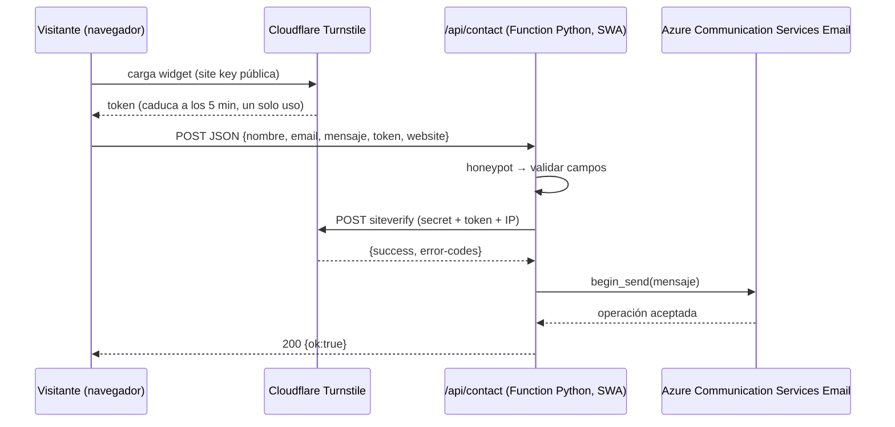

# Formulario de contacto — Diseño

## Arquitectura



Todo vive bajo el mismo dominio (`/api` lo enruta Static Web Apps), así que **no hay CORS**.

## Contrato de la API

`POST /api/contact` · `Content-Type: application/json`

Petición:

```json
{
  "nombre": "Ana Pérez",
  "email": "ana@ejemplo.com",
  "mensaje": "Hola Roger, me gustaría…",
  "token": "<cf-turnstile-response>",
  "website": ""
}
```

Respuestas:

| Código | Cuándo | Cuerpo |
| --- | --- | --- |
| `200` | Enviado, o honeypot activado | `{"ok": true}` |
| `400` | Validación fallida | `{"ok": false, "code": "validation", "fields": {"email": "Correo no válido"}}` |
| `400` | Captcha ausente/inválido | `{"ok": false, "code": "captcha", "message": "No pudimos verificar que eres humano. Inténtalo de nuevo."}` |
| `413` / `415` / `405` | Cuerpo grande / tipo / método | `{"ok": false, "code": "bad_request"}` |
| `500` | Error inesperado en la función | `{"ok": false, "code": "internal", "message": "No pudimos enviar tu mensaje. Inténtalo más tarde."}` |
| `503` | Turnstile o ACS no disponible | `{"ok": false, "code": "unavailable", "message": "No pudimos enviar tu mensaje. Inténtalo más tarde."}` |

## Estructura de `api/`

```
api/
  function_app.py          # registro de la función HTTP (modelo v2) y orquestación
  host.json
  requirements.txt         # azure-functions, azure-communication-email, httpx (o requests)
  local.settings.sample.json   # plantilla sin secretos; el real está en .gitignore
  contact/
    validation.py          # parseo y reglas de R5 (funciones puras)
    turnstile.py           # cliente de siteverify (timeout, idempotency_key opcional)
    mailer.py              # armado del mensaje y envío con EmailClient
    config.py              # lectura de variables de entorno (R10)
  tests/
    test_validation.py
    test_turnstile.py
    test_mailer.py
    test_endpoint.py
```

## Decisiones

1. **Cloudflare Turnstile** sobre reCAPTCHA/hCaptcha: gratuito, sin acertijos en la mayoría de casos y más respetuoso con la privacidad. *Verificado (V1):* el plan Free sigue vigente (hasta 20 widgets, 10 hostnames por widget, desafíos ilimitados).
2. **Función administrada de SWA** (plan Free) en lugar de una Function app propia: costo cero. Limitaciones aceptadas: solo triggers HTTP, sin Key Vault ni managed identity → los secretos van como *application settings* del recurso de Static Web Apps.
3. **Python 3.11** (`"platform": {"apiRuntime": "python:3.11"}` en `public/staticwebapp.config.json`, que Astro copia a `dist/`; SWA lo lee de la carpeta desplegada, no de `api/`). *Verificado (V2):* `python:3.11` es un valor admitido para funciones administradas (Functions 4.x, Linux, sin fecha de fin de soporte publicada). Se usa el **modelo v2** (`function_app.py`), que Microsoft recomienda para apps nuevas; la documentación de SWA no lo menciona de forma explícita, pero hay apps v2 funcionando en SWA administrada (V2). Por eso toda la lógica vive en `contact/` y `function_app.py` solo registra la ruta: si el primer despliegue (`azure-deploy`) no registra la función, se cambia al modelo v1 (`contact/function.json` + `__init__.py`) sin tocar la lógica.
4. **ACS Email**: cobra por correo y por MB (céntimos con este volumen). Arrancar con el *dominio administrado de Azure* (remitente `DoNotReply@<id>.azurecomm.net`) y migrar a un dominio propio con SPF/DKIM cuando exista el dominio. *Verificado (V3):* aprovisionar el dominio es gratis y ACS configura la autenticación del remitente; el dominio y el usuario del remitente no se pueden personalizar, y el límite es **5 correos/minuto y 10/hora por suscripción, sin ampliación** (solo los dominios propios verificados pueden pedir más). Suficiente para un formulario de contacto; si se supera, ACS responde `429` y la función devuelve `503` (R8). Alternativa descartada por ahora: servicio externo de correo con plan gratuito.
5. **Sin almacenamiento ni rate limit persistente** (evita costo): defensa por Turnstile + honeypot + límites de tamaño. Si aparece abuso, evaluar limitar por IP con un contador en memoria (mejor esfuerzo) antes de añadir recursos de pago.
6. **Reply-To:** incluir el correo del visitante en el cuerpo siempre y, además, como `replyTo`. *Verificado (V4):* el SDK `azure-communication-email` (1.1.0, Python ≥ 3.9) acepta en el mensaje de `begin_send` un campo de primer nivel `"replyTo": [{"address": "...", "displayName": "..."}]`. El correo del visitante ya llega validado y sin saltos de línea (R5).

## Frontend (Astro)

- Widget con **renderizado explícito** (*verificado, V5*): `turnstile.reset()` y `turnstile.getResponse()` exigen el `widgetId` que devuelve `turnstile.render()`, así que el renderizado implícito (`class="cf-turnstile"`) no sirve para R9. En el formulario va un contenedor `<div id="turnstile" data-sitekey={import.meta.env.PUBLIC_TURNSTILE_SITE_KEY}>` (sin la clase `cf-turnstile`). `contact.ts` define el callback de carga y después inserta `<script src="https://challenges.cloudflare.com/turnstile/v0/api.js?render=explicit&onload=onTurnstileLoad">`; ese callback llama a `turnstile.render('#turnstile', { sitekey })` y guarda el `widgetId`.
- Envío: pequeño script (sin librerías) en `src/scripts/contact.ts`, cargado con un `<script>` procesado por Astro, que toma el token con `turnstile.getResponse(widgetId)` (no depende del campo oculto `cf-turnstile-response`), hace `fetch('/api/contact', { method: 'POST', body: JSON.stringify(...) })`, gestiona el estado y llama a `turnstile.reset(widgetId)` si hay error de captcha. El token caduca a los 300 s y es de un solo uso (V5).
- **Compatibilidad con la CSP** (`script-src 'self'` sin `'unsafe-inline'`): Astro inlinea en el HTML los scripts procesados menores que `assetsInlineLimit` (4 KB por defecto; comprobado en `astro/dist/core/build/plugins/plugin-scripts.js`, Astro 7.4). Por eso se fija `vite.build.assetsInlineLimit: 0` para emitirlos siempre como archivo. Nada de `is:inline`, `define:vars` ni atributos `on*`; la site key llega al widget por `data-sitekey`.
- Campo `website`: oculto con CSS (no `display:none` si molesta a lectores; usar posición fuera de pantalla), `tabindex="-1"`, `autocomplete="off"`, `aria-hidden="true"`.
- Mensajes de estado en una región `role="status"` / `aria-live="polite"`.
- Sin JS: el formulario muestra un aviso `<noscript>` con el enlace de LinkedIn como alternativa.

## Variables de entorno

| Variable | Dónde | Secreta |
| --- | --- | --- |
| `TURNSTILE_SECRET_KEY` | App settings de SWA / `local.settings.json` | Sí |
| `ACS_CONNECTION_STRING` | App settings de SWA / `local.settings.json` | Sí |
| `MAIL_SENDER` | App settings (remitente verificado en ACS) | No |
| `MAIL_TO` | App settings (buzón destino) | No |
| `PUBLIC_TURNSTILE_SITE_KEY` | Variable de build de Astro (`.env`, GitHub Actions) | No |

Para pruebas locales se usan las **claves de prueba** de Turnstile (*verificado, V6*), que funcionan en cualquier dominio, `localhost` incluido. Cloudflare recomienda que la site key de producción **no** permita dominios locales, así que `localhost` se quitará del widget real cuando exista el dominio (`azure-deploy`).

| Uso | Site key (`PUBLIC_TURNSTILE_SITE_KEY`) | Secret key (`TURNSTILE_SECRET_KEY`) |
| --- | --- | --- |
| Siempre pasa | `1x00000000000000000000AA` | `1x0000000000000000000000000000000AA` |
| Siempre falla | `2x00000000000000000000AB` | `2x0000000000000000000000000000000AA` |
| Token ya usado (`timeout-or-duplicate`) | — | `3x0000000000000000000000000000000AA` |

Son valores públicos de la documentación de Cloudflare, no secretos.

## Verificaciones (T0.2, 27-oct-2026)

Conclusiones contrastadas con la documentación oficial para los puntos que estaban marcados como VERIFICAR:

- **V1 — Turnstile Free:** gratis; 20 widgets, 10 hostnames por widget, desafíos ilimitados. [Planes de Turnstile](https://developers.cloudflare.com/turnstile/plans/)
- **V2 — Python en SWA administrada:** `python:3.11` admitido (Functions 4.x). Solo triggers HTTP; sin managed identity ni referencias a Key Vault; prefijos de app settings reservados (`FUNCTIONS_`, `WEBSITE_`, `AZURE_FUNCTION_`, etc.), que nuestras variables no usan. El modelo v2 es el recomendado por Functions; SWA no lo documenta de forma explícita, pero hay apps v2 en SWA administrada ([issue #1478](https://github.com/Azure/static-web-apps/issues/1478)). [Lenguajes y runtimes de SWA](https://learn.microsoft.com/azure/static-web-apps/languages-runtimes) · [Funciones en SWA](https://learn.microsoft.com/azure/static-web-apps/apis-functions) · [Referencia de Python](https://learn.microsoft.com/azure/azure-functions/functions-reference-python)
- **V3 — Dominio administrado de ACS:** gratis; remitente no personalizable; 5 correos/min y 10/hora por suscripción, sin ampliación; tamaño máximo de la petición 10 MB. [Dominios administrados](https://learn.microsoft.com/azure/communication-services/quickstarts/email/add-azure-managed-domains) · [Límites](https://learn.microsoft.com/azure/communication-services/concepts/service-limits)
- **V4 — SDK de correo:** `azure-communication-email` 1.1.0 (17-oct-2025, Python ≥ 3.9). `EmailClient.from_connection_string(...)`, `begin_send(message)` devuelve un poller; mensaje con `senderAddress`, `recipients.to[]`, `content.{subject, plainText, html}` y `replyTo[]` (`{address, displayName}`). Errores como `azure.core.exceptions.HttpResponseError`. [README del SDK](https://learn.microsoft.com/python/api/overview/azure/communication-email-readme) · [PyPI](https://pypi.org/project/azure-communication-email/)
- **V5 — Widget y siteverify:** script `https://challenges.cloudflare.com/turnstile/v0/api.js` (`?render=explicit` para renderizado explícito); `reset`, `getResponse`, `remove` e `isExpired` reciben el `widgetId`. Token válido 300 s, un solo uso, máximo 2048 caracteres. Siteverify: `POST https://challenges.cloudflare.com/turnstile/v0/siteverify`, acepta JSON o form-urlencoded con `secret`, `response`, `remoteip` (opcional) e `idempotency_key` (opcional); responde `success`, `error-codes`, `hostname`, `challenge_ts`. Códigos: `missing-input-secret`, `invalid-input-secret`, `missing-input-response`, `invalid-input-response`, `bad-request`, `timeout-or-duplicate`, `internal-error`. Mapeo: errores del token → `400 captcha` (R2); errores de secreto, `internal-error`, timeout o fallo de red → `503 unavailable` (R8). [Renderizado en cliente](https://developers.cloudflare.com/turnstile/get-started/client-side-rendering/) · [Validación en servidor](https://developers.cloudflare.com/turnstile/get-started/server-side-validation/)
- **V6 — Claves de prueba:** ver la tabla de «Variables de entorno». [Testing](https://developers.cloudflare.com/turnstile/troubleshooting/testing/)

## Riesgos

- Token de Turnstile caduca o se reutiliza → el frontend reinicia el widget tras cada error (R9).
- Cold start de la función → el usuario ve «Enviando…» unos segundos; aceptable.
- Cambios en ACS Email (Microsoft advierte de cambios incompatibles en algunos servicios) → aislar el envío en `mailer.py`.
