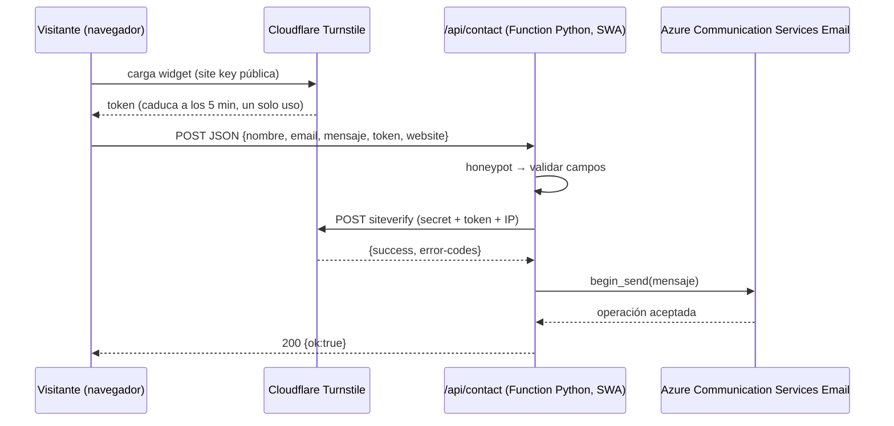

# Formulario de contacto — Diseño

## Arquitectura



Todo vive bajo el mismo dominio (`/api` lo enruta Static Web Apps), así que **no hay CORS**.

## Contrato de la API

`POST /api/contact` · `Content-Type: application/json`

Petición:

```json
{
  "nombre": "Ana Pérez",
  "email": "ana@ejemplo.com",
  "mensaje": "Hola Roger, me gustaría…",
  "token": "<cf-turnstile-response>",
  "website": ""
}
```

Respuestas:

| Código | Cuándo | Cuerpo |
| --- | --- | --- |
| `200` | Enviado, o honeypot activado | `{"ok": true}` |
| `400` | Validación fallida | `{"ok": false, "code": "validation", "fields": {"email": "Correo no válido"}}` |
| `400` | Captcha ausente/inválido | `{"ok": false, "code": "captcha", "message": "No pudimos verificar que eres humano. Inténtalo de nuevo."}` |
| `413` / `415` / `405` | Cuerpo grande / tipo / método | `{"ok": false, "code": "bad_request"}` |
| `500` | Error inesperado en la función | `{"ok": false, "code": "internal", "message": "No pudimos enviar tu mensaje. Inténtalo más tarde."}` |
| `503` | Turnstile o ACS no disponible | `{"ok": false, "code": "unavailable", "message": "No pudimos enviar tu mensaje. Inténtalo más tarde."}` |

## Estructura de `api/`

```
api/
  function_app.py          # registro de la función HTTP (modelo v2) y orquestación
  host.json
  requirements.txt         # azure-functions, azure-communication-email, httpx (o requests)
  local.settings.sample.json   # plantilla sin secretos; el real está en .gitignore
  contact/
    validation.py          # parseo y reglas de R5 (funciones puras)
    turnstile.py           # cliente de siteverify (timeout, idempotency_key opcional)
    mailer.py              # armado del mensaje y envío con EmailClient
    config.py              # lectura de variables de entorno (R10)
  tests/
    test_validation.py
    test_turnstile.py
    test_mailer.py
    test_endpoint.py
```

## Decisiones

1. **Cloudflare Turnstile** sobre reCAPTCHA/hCaptcha: gratuito, sin acertijos en la mayoría de casos y más respetuoso con la privacidad. *VERIFICAR* en el panel de Cloudflare que el plan gratuito sigue vigente.
2. **Función administrada de SWA** (plan Free) en lugar de una Function app propia: costo cero. Limitaciones aceptadas: solo triggers HTTP, sin Key Vault ni managed identity → los secretos van como *application settings* del recurso de Static Web Apps.
3. **Python 3.11** (`"platform": {"apiRuntime": "python:3.11"}` en `public/staticwebapp.config.json`, que Astro copia a `dist/`; SWA lo lee de la carpeta desplegada, no de `api/`). *VERIFICAR* que SWA administrada acepte el modelo de programación v2 (`function_app.py`); si no, usar el modelo v1 (`contact/function.json` + `__init__.py`) con la misma lógica en `contact/`.
4. **ACS Email**: cobra por correo y por MB (céntimos con este volumen). Arrancar con el *dominio administrado de Azure* (remitente `DoNotReply@<id>.azurecomm.net`) y migrar a un dominio propio con SPF/DKIM cuando exista el dominio. *VERIFICAR* en el portal. Alternativa descartada por ahora: servicio externo de correo con plan gratuito.
5. **Sin almacenamiento ni rate limit persistente** (evita costo): defensa por Turnstile + honeypot + límites de tamaño. Si aparece abuso, evaluar limitar por IP con un contador en memoria (mejor esfuerzo) antes de añadir recursos de pago.
6. **Reply-To:** incluir el correo del visitante en el cuerpo siempre; configurarlo además como `replyTo` solo si el SDK lo soporta (*VERIFICAR* el formato en la referencia del SDK `azure-communication-email`).

## Frontend (Astro)

- Widget: `<script src="https://challenges.cloudflare.com/turnstile/v0/api.js" async defer></script>` y un `<div class="cf-turnstile" data-sitekey={import.meta.env.PUBLIC_TURNSTILE_SITE_KEY}>` dentro del formulario. *VERIFICAR* atributos y nombre del campo (`cf-turnstile-response`) en la documentación oficial.
- Envío: pequeño script (sin librerías) en `src/scripts/contact.ts`, cargado con un `<script>` procesado por Astro, que hace `fetch('/api/contact', { method: 'POST', body: JSON.stringify(...) })`, gestiona el estado y llama a `turnstile.reset()` si hay error de captcha.
- **Compatibilidad con la CSP** (`script-src 'self'` sin `'unsafe-inline'`): Astro inlinea en el HTML los scripts procesados menores que `assetsInlineLimit` (4 KB por defecto; comprobado en `astro/dist/core/build/plugins/plugin-scripts.js`, Astro 7.4). Por eso se fija `vite.build.assetsInlineLimit: 0` para emitirlos siempre como archivo. Nada de `is:inline`, `define:vars` ni atributos `on*`; la site key llega al widget por `data-sitekey`.
- Campo `website`: oculto con CSS (no `display:none` si molesta a lectores; usar posición fuera de pantalla), `tabindex="-1"`, `autocomplete="off"`, `aria-hidden="true"`.
- Mensajes de estado en una región `role="status"` / `aria-live="polite"`.
- Sin JS: el formulario muestra un aviso `<noscript>` con el enlace de LinkedIn como alternativa.

## Variables de entorno

| Variable | Dónde | Secreta |
| --- | --- | --- |
| `TURNSTILE_SECRET_KEY` | App settings de SWA / `local.settings.json` | Sí |
| `ACS_CONNECTION_STRING` | App settings de SWA / `local.settings.json` | Sí |
| `MAIL_SENDER` | App settings (remitente verificado en ACS) | No |
| `MAIL_TO` | App settings (buzón destino) | No |
| `PUBLIC_TURNSTILE_SITE_KEY` | Variable de build de Astro (`.env`, GitHub Actions) | No |

Para pruebas locales Cloudflare publica claves de prueba de Turnstile (*VERIFICAR* sus valores en la documentación).

## Riesgos

- Token de Turnstile caduca o se reutiliza → el frontend reinicia el widget tras cada error (R9).
- Cold start de la función → el usuario ve «Enviando…» unos segundos; aceptable.
- Cambios en ACS Email (Microsoft advierte de cambios incompatibles en algunos servicios) → aislar el envío en `mailer.py`.
